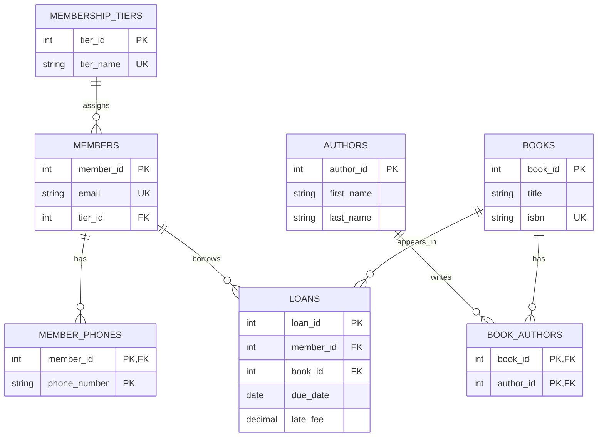
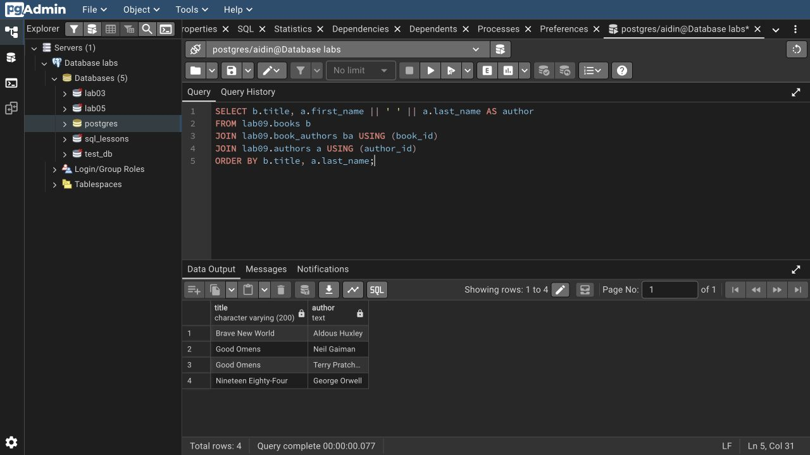

# Lab 9: Database design basics

I modeled a small library that tracks books, authors, members, phone numbers, and loans. Members can borrow several books, and books can have several authors. The sample data includes two loans, one returned late with a fee.

Entities become tables; attributes become columns. A first name is simple, an address can be split into street/city/postcode, age is derived from birth date, and an ID is a key attribute. Requirements lead to an ER model, normalized tables, then PostgreSQL types, constraints and indexes.

Run from the repository root:

```bash
psql -X -a -v ON_ERROR_STOP=1 -U aidin -d postgres -f lab-09/psql-demo.sql
```



`member_phones` gives each phone number its own row (1NF). Book titles stay in `books`, not in the `book_authors` junction table (2NF). A member stores `tier_id`, while the tier name stays in `membership_tiers` (3NF). Primary and foreign keys keep the relationships valid.

Rerunning resets only `lab09`. The schema and query results are in the [full session](outputs/psql-session.txt).

[Course document](https://drive.google.com/file/d/1UjwMCGbcdKjChfTVb-8JA_Ixq6cw7IJQ/view)


