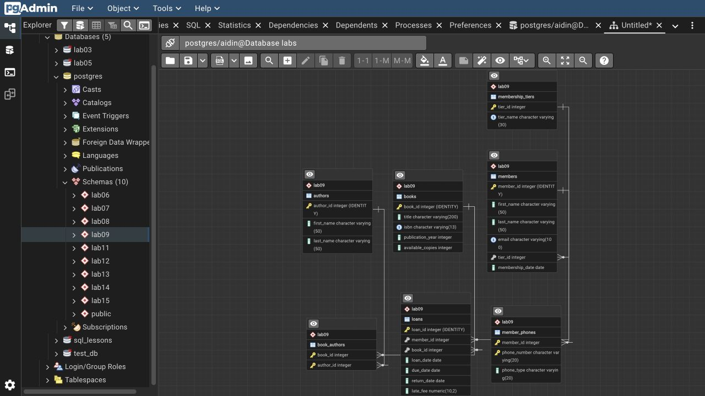
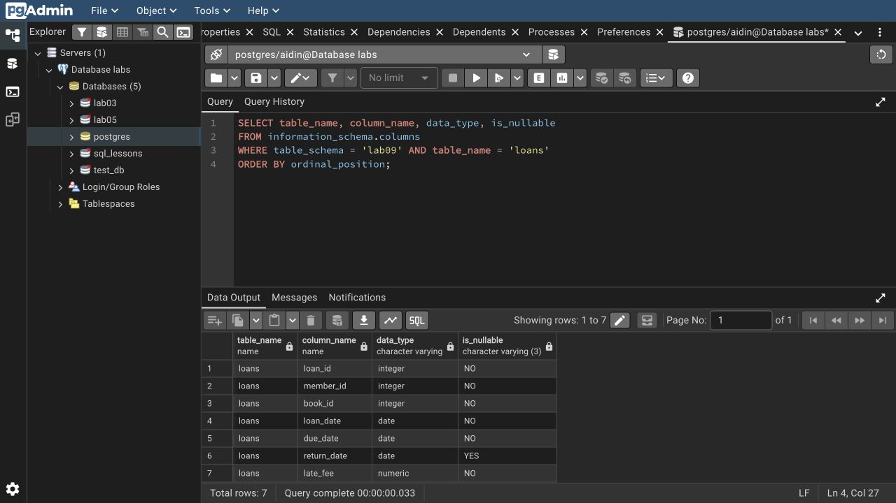

# Lab 10: Viewing database and table structure

I used `\dt lab09.*` to list the library tables and `\d` to inspect the columns, indexes, and relationships in four of them. The SQL queries then list columns and constraints from PostgreSQL's catalog.

Run Lab 9 first, then run this from the repository root:

```bash
psql -X -a -v ON_ERROR_STOP=1 -U aidin -d postgres -f lab-10/psql-demo.sql
```

The [ER diagram in Lab 9](../lab-09/README.md) shows the same relationships. `book_authors` has two foreign keys and a composite primary key; `loans` connects each member to a book. The [full session](outputs/psql-session.txt) contains the table descriptions and catalog results.

The ERD generated from `lab09` in pgAdmin shows seven tables and six foreign keys.



[Course document](https://drive.google.com/file/d/10Mzs-G_WIk6rxG1QF6IywiR-CuzAKEPC/view)


