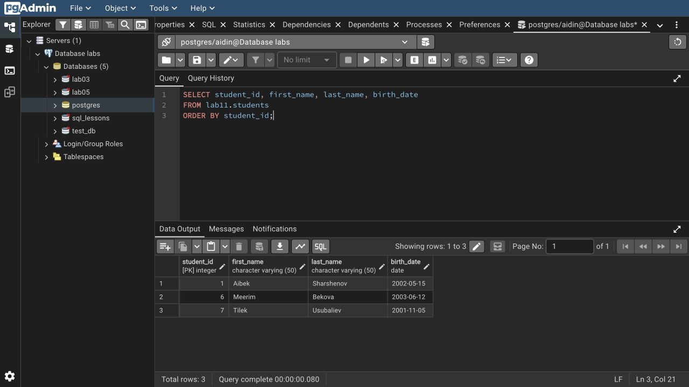

# Lab 11: Basic data operations

I inserted single and multiple rows, updated a birth date, deleted selected rows and imported three records from CSV. Bulk update changed Isakov to Bekov; bulk delete removed IDs 3 and 5. IDs 1, 6 and 7 remain.

`WHERE` limits updates and deletes. `RETURNING` shows affected rows. `\copy` reads a client file; SQL `COPY` reads a server file. Run `psql-demo.sql` for the complete lab, including CSV import and bulk changes.

```bash
psql -X -a -v ON_ERROR_STOP=1 -U aidin -d postgres -f lab-11/psql-demo.sql
```

Rerunning resets only `lab11`.

[SQL](lab11.sql) · [Full session](outputs/psql-session.txt) · [Course document](https://drive.google.com/file/d/1RVpvu9cB8a5DvNdprKtkErKihBPt3OMs/view)


