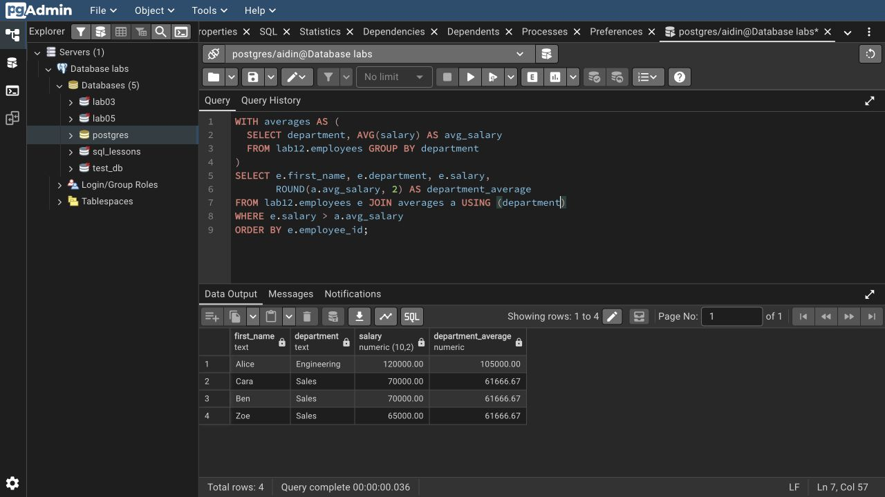

# Lab 12: Querying data

I used comparisons, `AND`/`OR`/`NOT`, `BETWEEN`, null checks, `LIKE`, `ILIKE`, regular expressions, `IN`, `EXISTS`, `CASE` and a CTE.

`IN` and `EXISTS` both find Cara and Ben with sales above 1,000. Alice, Cara, Ben and Zoe earn above their department average. `%` matches any number of characters; `_` matches one. Use `IS NULL` to test missing values.

```bash
psql -X -a -v ON_ERROR_STOP=1 -U aidin -d postgres -f lab-12/psql-demo.sql
```

Rerunning resets only `lab12`.

[SQL](lab12.sql) · [Full session](outputs/psql-session.txt) · [Course document](https://drive.google.com/file/d/1-cihprgNppU8XEBNQh3kplBKjd1-9UPL/view)


