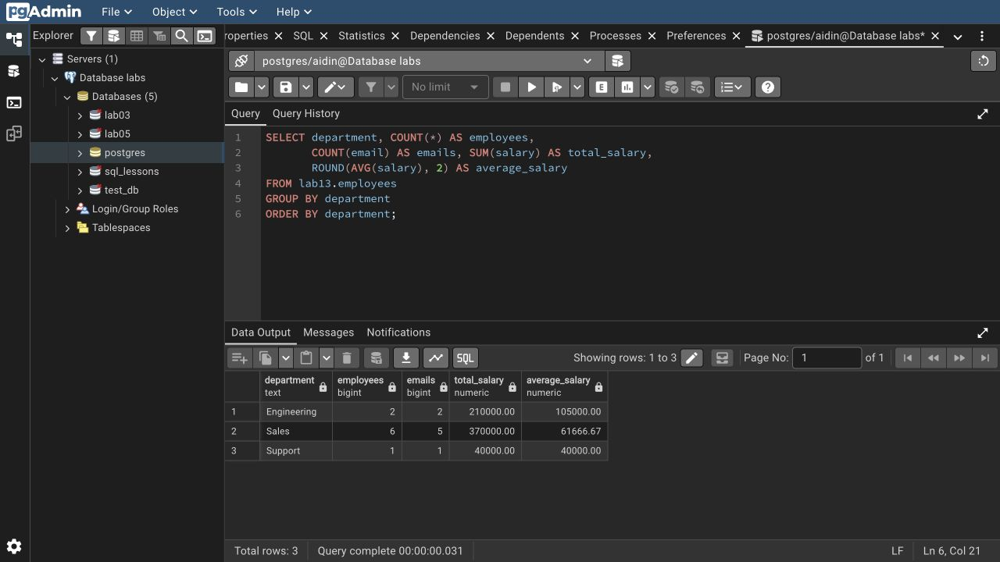

# Lab 13: Aggregate functions

I tested `COUNT`, `SUM`, `AVG`, `MIN`, `MAX`, string/array aggregation, standard deviation, variance and correlation. Grouping includes several columns and calculated age bands.

The data has 9 employees, 8 emails and 3 departments. Total salary is 620,000. Sales has 6 employees and passes `HAVING COUNT(*) > 5`.

`WHERE` filters rows before grouping; `HAVING` filters groups. `COUNT(*)` includes every row; `COUNT(column)` skips nulls. Window aggregates preserve individual rows. The script also calculates conditional counts and department percentages.

```bash
psql -X -a -v ON_ERROR_STOP=1 -U aidin -d postgres -f lab-13/psql-demo.sql
```

Rerunning resets only `lab13`.

[SQL](lab13.sql) · [Full session](outputs/psql-session.txt) · [Course document](https://drive.google.com/file/d/1CU4xZzAL52Sm0nzcEufCutvlu2C2Z2Yi/view)


