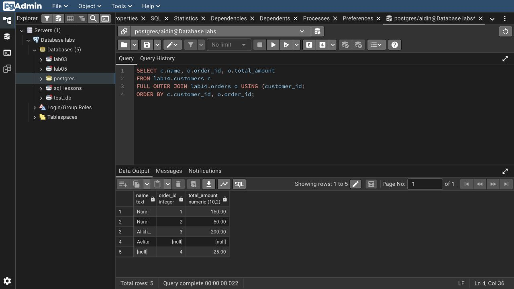

# Lab 14: Joining tables

I ran inner, left, right, full and cross joins, a four-table join, a self join and joins across 1:1, 1:N and N:M relationships.

| Join | Rows |
| --- | ---: |
| Inner | 3 |
| Left | 4 |
| Right | 4 |
| Full | 5 |
| Cross, 3 customers × 2 products | 6 |

Aelita has no order; order 4 is a guest order with a null customer ID. Outer joins preserve those unmatched rows. N:M queries go through the junction table. Aliases improve readability; indexes and the query plan determine performance.

```bash
psql -X -a -v ON_ERROR_STOP=1 -U aidin -d postgres -f lab-14/psql-demo.sql
```

Rerunning resets only `lab14`.

[SQL](lab14.sql) · [Full session](outputs/psql-session.txt) · [Course document](https://drive.google.com/file/d/1LxE7hZ0vhc3xIfryMtvSnM64u8A0xoH0/view)


