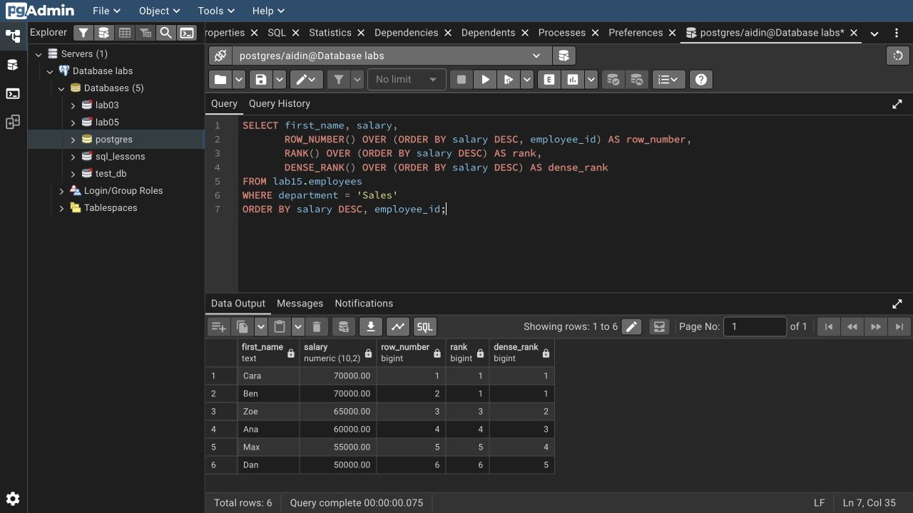

# Lab 15: Advanced querying

I tested scalar, row and table subqueries, CTEs, a recursive hierarchy, all four set operations, window functions, pivot/unpivot, `FILTER` and custom sorting.

The hierarchy contains 9 employees. `UNION` returns 3 products; `UNION ALL` keeps 4 rows. `INTERSECT` finds Book; `EXCEPT` finds Pen. Pivot gives 2 rows, and unpivot restores all 6 annual sales records.

`ROW_NUMBER` gives distinct positions; `RANK` leaves gaps after ties; `DENSE_RANK` does not. `LAG`/`LEAD` read adjacent rows. The running total uses an explicit `ROWS` frame.

`EXPLAIN` shows estimates; `EXPLAIN ANALYZE` executes the query. An index is present, but a sequential scan can be cheaper for this small dataset.

```bash
psql -X -a -v ON_ERROR_STOP=1 -U aidin -d postgres -f lab-15/psql-demo.sql
```

Rerunning resets only `lab15`.

[SQL](lab15.sql) · [Full session](outputs/psql-session.txt) · [Course document](https://drive.google.com/file/d/1gU37bli-KJzA6MgdamHLFV24tYdpaHL8/view)


